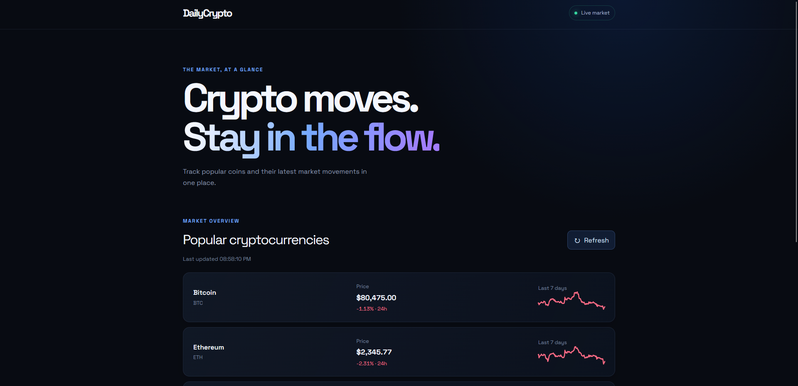

# DailyCrypto

<p>
   
</p>

A sleek, responsive cryptocurrency dashboard for tracking popular coins, their current USD prices, and recent market trends.

https://okamicoder.github.io/DailyCrypto/

## Features

- Live USD prices for Bitcoin, Ethereum, Solana, BNB, and XRP
- 24-hour price change indicators
- Seven-day sparkline charts
- Manual refresh and automatic updates
- Responsive dark interface with blue accents

## Built With

- HTML
- CSS
- Tailwind CSS
- JavaScript
- Vue 3
- CoinGecko API

## Getting Started

1. Clone the repository:

   ```bash
   git clone https://github.com/OkamiCoder/DailyCrypto.git
   ```

2. Open the project folder.

3. Add your CoinGecko Demo API key to `script.js` if required by the API:

   ```javascript
   apiKey: "YOUR_COINGECKO_DEMO_API_KEY",
   ```

4. Run the project through a local web server, such as the VS Code Live Server extension.

## Project Files

- `index.html` - page structure and Vue app
- `style.css` - custom styles and responsive layout
- `script.js` - API requests, price formatting, and charts

## Data Source

Market data is provided by the CoinGecko API. Prices may be delayed and are for informational purposes only.

## Note About API Keys

This is a frontend-only project. Any API key placed in `script.js` is visible to visitors in the browser. Do not use a private or sensitive key in client-side code.

## Author

OkamiCoder

